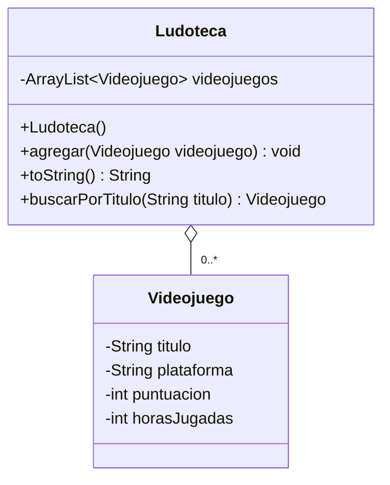

Ludoteca tiene una lista donde guarda diferentes videojuegos. Estos videojuegos se pueden crear por separado y seguir existiendo aunque se eliminen de la ludoteca.
No utilizamos herencia porque una ludoteca no es un videojuego, sino que sirve para guardar y organizar varios videojuegos.